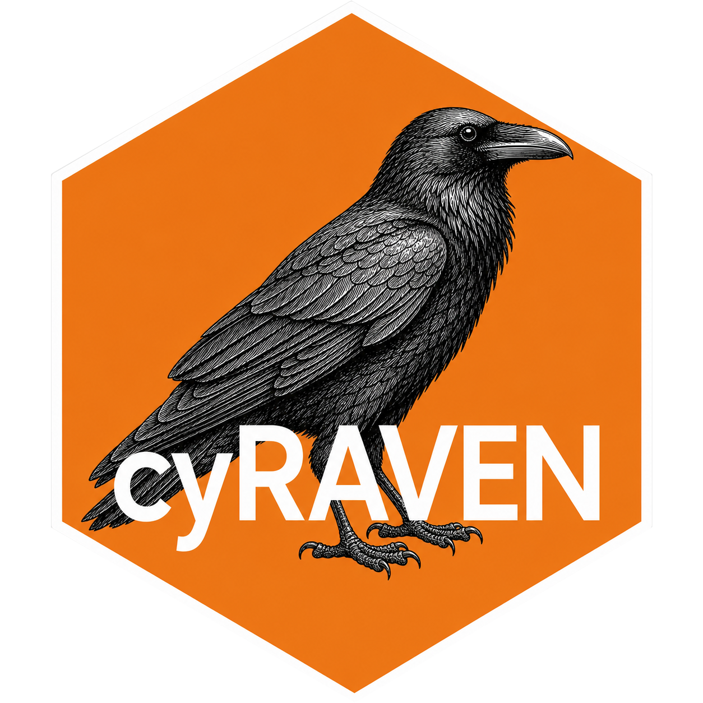

# cyRAVEN 

<!-- badges: start -->
[](https://github.com/bhagesh-h/cyRAVEN/actions/workflows/R-CMD-check.yaml)
[](https://github.com/bhagesh-h/cyRAVEN/actions/workflows/pkgdown.yaml)
[](https://www.gnu.org/licenses/gpl-3.0)
<!-- badges: end -->

<div class="readme-only">

**Documentation: <https://bhagesh-h.github.io/cyRAVEN/>**

</div>

cyRAVEN turns a folder of flow cytometry (FCS) files into population
frequencies, marker expression, a UMAP and group statistics. You list the
populations in a short YAML file; cyRAVEN gates every sample separately and
writes one `report.html`.

## Quick start

You need [Docker](https://docs.docker.com/get-docker/). Four commands, then
open one file.

**1. Get the image**

```bash
docker pull bhagesh/cyraven:1.0.0
docker tag bhagesh/cyraven:1.0.0 \
  cyraven:1.0.0
```

**2. Write the demo data**: 35 FCS files, a sample sheet and a config.

```bash
docker run --rm -v "$PWD:/w" \
  cyraven:1.0.0 --demo /w/demo
```

**3. Check the inputs.** Takes seconds. It should end with
`no problems found`.

```bash
docker run --rm \
  -v "$PWD/demo:/data:ro" \
  -v "$PWD/results:/results" \
  cyraven:1.0.0 \
  --dir /data/fcs \
  --samples /data/samples.csv \
  --config /data/panel.yaml \
  --group-column cohort \
  --reference-group "GvHD grade 1" \
  --outdir /results \
  --check
```

**4. Run it.** A few minutes.

```bash
docker run --rm \
  -v "$PWD/demo:/data:ro" \
  -v "$PWD/results:/results" \
  cyraven:1.0.0 \
  --dir /data/fcs \
  --samples /data/samples.csv \
  --config /data/panel.yaml \
  --group-column cohort \
  --reference-group "GvHD grade 1" \
  --outdir /results
```

**5. Open `results/report.html`.** Every figure and table is in that one
file.

On Windows, run these in Git Bash or WSL with `MSYS_NO_PATHCONV=1` in front
of each command. In PowerShell, end each continued line with a backtick
instead of `\`, and write `${PWD}` for `$PWD`.

## How it works

```
FCS files · sample sheet · config
                ▼
        1  Read the files
                ▼
       2  Gate each sample
                ▼
      3  Score populations
                ▼
     4  Uncertainty and UMAP
                ▼
        5  Compare groups
                ▼
           report.html
```

1. **Read.** Each file is opened and its channels are matched to markers.
   Acquisition stability over time is checked.
   → `acquisition_qc.csv`
2. **Gate each sample.** Leukocytes, singlets, live cells and CD45+ cells are
   found first. Then each marker is cut at the lowest point between its
   negative and positive peaks, inside that sample.
   → `thresholds_used.csv`, `gating_qc.png`
3. **Score populations.** Cells meeting each rule in your YAML are counted,
   for example `CD3: above` and `CD4: above`.
   → `population_frequencies.csv`
4. **Uncertainty and UMAP.** Each cut is re-derived on resampled events to
   see how far it moves. A UMAP is built with about the same number of cells
   from each sample, or every gated cell with `--no-equalise`.
   → `threshold_uncertainty.csv`, `umap_overview.png`
5. **Compare.** Groups are tested with one value per sample. Populations are
   tested against clinical variables and followed across visits.
   → `group_comparison_stats.csv`, `clinical_association.csv`

If a marker shows no gap between negative and positive cells, step 2 uses a
fixed percentile instead and labels the cut `quantile_fallback`. The
population is still reported; check it before you use the number.

## What it can do

| Feature | Flag |
|---|---|
| A gate placed inside each sample | always on |
| Uncertainty for every cut and frequency | on by default |
| Several smoothing levels and gate shapes | `--adaptive-gates` |
| Skip a gate the data cannot support | `--auto-fix-gates` |
| Tests between groups | `--group-column` |
| Clinical scores and lab values | `--clinical-columns` |
| Absolute cell numbers | `--total-counts` |
| Every figure again per visit | `--split-by-timepoint` |
| Batch check, and correction | `--batch-column`, `--correct-batch` |
| Clustering, for unlisted populations | `--explore` |
| FMO controls as gate references | `fmo_for` column |
| FCS files with gate columns, for FlowJo | `--flowjo-export` |
| Gating-ML 2.0 gate export | `--export-gates` |

## Your own data

You write two files: a **sample sheet** (one row per FCS file) and a
**config** (the populations to score). Start both from a template.

```bash
docker run --rm -v "$PWD/data:/data" \
  cyraven:1.0.0 \
  --dir /data/fcs --recursive \
  --write-samples /data/samples.csv
```

```bash
docker run --rm -v "$PWD/data:/data" \
  cyraven:1.0.0 \
  --write-template /data/analysis.yaml
```

Fill in the sheet's `patient_id` and group columns, and edit the
`populations:` section of the config. Run with `--check` until it reports no
problems, then run without it.
[Get started](https://bhagesh-h.github.io/cyRAVEN/articles/cyRAVEN.html) explains both files and every
option.

## Before you use a number

- **Open `gating_qc.png` first.** It draws each cut on the data it came
  from. A cut on the side of a peak, instead of in the gap, is visible there
  and in no table.
- **A `quantile_fallback` cut found no gap.** Look at that population before
  you report it.
- **Frequencies are shares of CD45+ cells.** One population's share can rise
  because another fell, with no change in its cell number. Only
  `--total-counts` shows a change in size.
- **Tests use one value per sample**, never single cells, so a longer
  acquisition does not inflate significance. With several samples per
  patient, pair them with `--paired-column patient_id` and
  `--condition-column timepoint`.

## Why gate each sample separately

Manual gating varies between operators. When 38 operators gated the same
files, the median expanded uncertainty was 3.6%, and experience made no
significant difference (Grant et al., 2021, *PDA J Pharm Sci Technol* 75:33).
Across 320 clinical samples analysed by six technologists, the remaining
spread followed the operator more than the instrument (Mead et al., 2026,
*Cytometry B*, doi:10.1002/cyto.b.70048).

Copying one set of gate coordinates to every sample does not fix this.
Samples stain with different intensity, so a fixed cut suits some and not
others. cyRAVEN places each cut inside its own sample and reports how
precisely that cut is determined.

## Documentation

| Page | For |
|---|---|
| [Get started](https://bhagesh-h.github.io/cyRAVEN/articles/cyRAVEN.html) | The two input files and every option |
| [About](https://bhagesh-h.github.io/cyRAVEN/articles/about.html) | What each stage does, and why |
| [Flow cytometry](https://bhagesh-h.github.io/cyRAVEN/articles/flow-cytometry.html) | Events, gates and channels, for newcomers |
| [Advanced](https://bhagesh-h.github.io/cyRAVEN/articles/advanced.html) | Explore mode, diagnostics, every output |
| [Gallery](https://bhagesh-h.github.io/cyRAVEN/articles/gallery.html) | Every figure, and how to read it |
| [Limitations](https://bhagesh-h.github.io/cyRAVEN/articles/limitations.html) | What results can and cannot support |
| [Reference](https://bhagesh-h.github.io/cyRAVEN/reference/index.html) | Every exported R function |

Everything is also in one PDF:
[cyRAVEN-manual.pdf](https://bhagesh-h.github.io/cyRAVEN/cyRAVEN-manual.pdf).

## Without Docker

Docker pins R 4.4.3, a dated CRAN snapshot and Bioconductor 3.20. Newer
package versions can move gates and UMAP coordinates slightly, so results
may differ a little outside it.

```r
install.packages("BiocManager")
BiocManager::install("flowCore")
remotes::install_github("bhagesh-h/cyRAVEN")
```

```r
library(cyRAVEN)
write_demo_cohort("demo")
run_cyraven(list(
  dir = "demo/fcs", outdir = "results",
  samples = "demo/samples.csv",
  config = "demo/panel.yaml",
  group_column = "cohort",
  reference_group = "GvHD grade 1"))
```

The chapters are not installed with the package, so `browseVignettes()`
returns nothing; function help such as `?run_cyraven` is installed.

## Citation

```r
citation("cyRAVEN")
```

If you use the clustering, also cite FlowSOM (Van Gassen et al., 2015,
*Cytometry A* 87:636). For the differential state tests, also cite diffcyt
(Weber et al., 2019, *Commun Biol* 2:183).

## How parts of this were written

Commit messages and parts of the documentation were drafted with Anthropic's
Claude through [Claude Code](https://claude.com/claude-code). The code and
its results are the author's, and every number in the documentation comes
from a run. If the documentation and the package disagree, please
[open an issue](https://github.com/bhagesh-h/cyRAVEN/issues).

## Licence

GPL-3. See [LICENSE](https://github.com/bhagesh-h/cyRAVEN/blob/main/LICENSE).
